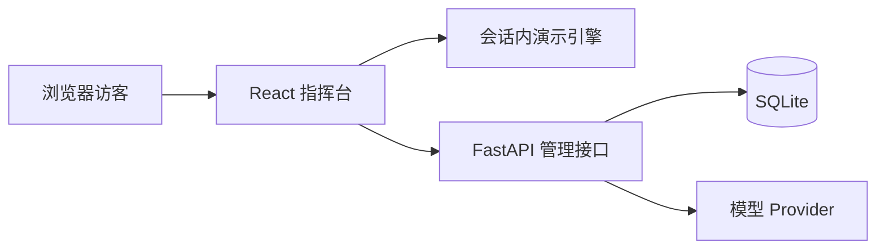

# VoyageDeck AI · 出海星舰

六岗位跨境运营演示指挥台，覆盖选品、上架、内容制作、投流、客服和履约。访客沙盒使用虚构产品和模拟交易。

## Windows 本地启动

需要 Node.js 22 和 Python 3.12。在仓库根目录使用 PowerShell：

```powershell
py -3.12 -m venv backend/.venv
.\backend\.venv\Scripts\python.exe -m pip install -r backend/requirements-dev.txt
Push-Location frontend
npm.cmd ci
Pop-Location
.\scripts\dev.ps1
```

- 指挥台 <http://127.0.0.1:5177>
- 健康检查 <http://127.0.0.1:8289/api/health>
- OpenAPI <http://127.0.0.1:8289/api/docs>

在启动终端按 `Ctrl+C` 结束服务。



VoyageDeck AI is a mission-control console for a simulated six-agent cross-border commerce workflow.
