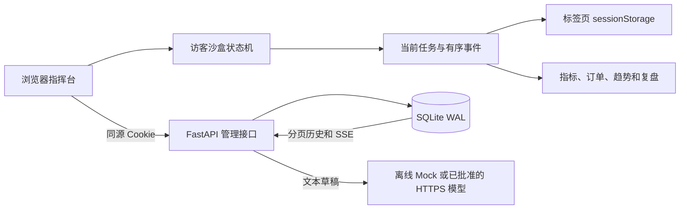
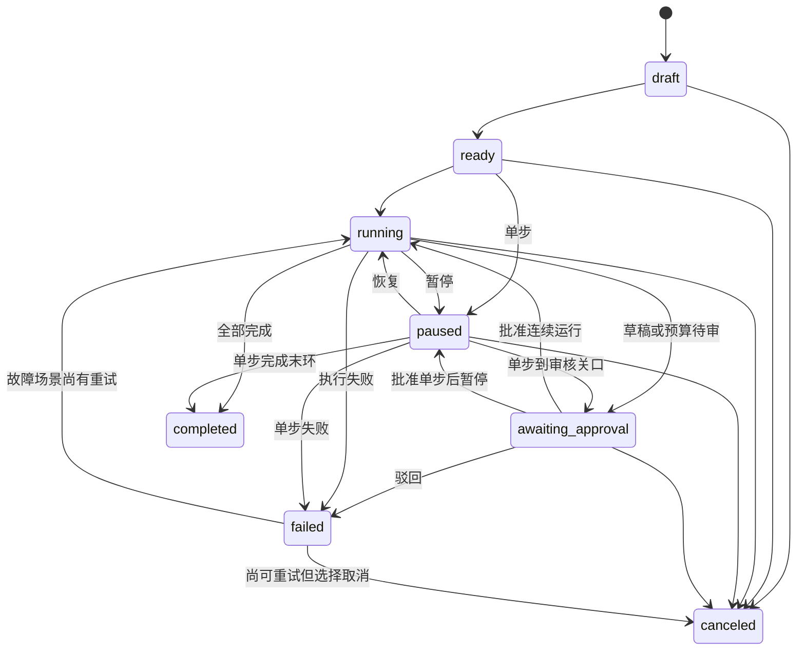

# 架构与数据来源

## 两种执行方式

**访客演示**使用 React、TypeScript 和 Vite。首次打开先按规则回放标准工作流，再停在履约检查点。启动自己建立的任务时，从三个虚构候选开始。在一个由浏览器驱动的 reducer 里验证任务转换、审批目标和当前尝试编号。每次执行、审批和业务事实变化生成有序记录。流程节点、岗位卡、终端、统计和下载复盘读取同一份状态。

当前任务及最多 12 个归档任务保存在该标签页的 `sessionStorage`。刷新恢复该页的快照与事件，禁用存储时降级到内存。新建独立任务会归档上一轮，重置会替换当前沙盒。匿名访客运行无需 AI 密钥、数据库或服务器写接口，访客业务事实与管理员历史之间没有同步。

**管理后台**通过同源 FastAPI 接口登录、保存非敏感 Provider 参数、对某个岗位生成草稿和人工审阅。每条管理记录有工作流 UUID、岗位任务 UUID、请求 UUID、可选产物 UUID 和 UTC 时间戳。一条管理工作流对应一次岗位文本推理。访客的六岗位流程在沙盒内完整串行执行。

管理事件按工作流保存，可通过 SSE 或带游标的 JSON 历史接口读取。管理界面在选择记录与完成操作后读取 JSON 历史。API SSE 可供需要持续订阅的客户端使用，连接和断线回放已通过本地接口测试。

## 演示状态机

任务从待命、排队到执行。上架、模拟预算必须通过各自的审批。错误与驳回记录保留在事件和产物中，终止后将下游标为跳过。重复启动和重复审批由 reducer 忽略，故障场景内容官最多两次人工重试。连续运行每 1.15 秒推进一次，暂停时 reducer 也拒绝迟到的计时动作。单步处理当前岗位而后停住，若到审批点则等人确认。

## 业务事实与复算

| 事实 | 产生节点 | 界面用途 |
| --- | --- | --- |
| 候选、评分与淘汰原因 | Scout 按需求 30%、毛利 35%、低竞争度 15%、低合规风险 10%、供应可靠性 10% 评分，规则门槛独立执行 | 商品决策、岗位详情、复盘 |
| 上架、内容、投流与客服草稿 | 各岗位生成带任务、尝试编号与数据来源的结构化产物 | 审批、复制、审阅分镜或英语草稿 |
| 模拟支出与订单 | Ads 预算获批时登记支出与两笔模拟订单，金额使用整数美分 | 金额卡、趋势、订单日志 |
| 库存占用、发货、退款、物流成本 | Fulfillment 对每单处理，记录库存和事件对应关系 | 订单明细、经营口径、复盘 |

GMV 以未取消订单的商品成交额计算，退款单仍计入成交额，退款金额另列。净销售额等于 GMV 减退款。商品毛利等于净销售额减商品采购成本。广告 ROAS 等于广告归因订单的净销售额除以模拟广告支出。估算贡献利润进一步扣除物流、平台费、模拟广告支出和其它记录的可变费用。净销售额或模拟广告支出作为分母为零时，对应比率显示 `N/A`。

标准情景为两笔 $49.00 的模拟订单，净销售额 $98.00，广告归因净销售额 $49.00，广告支出 $26.80。采购 $36.00、物流 $9.60、平台费 $5.88，估算贡献利润 $19.72。换品情景因库存不足退第二单 $42.00，GMV $84.00，净销售额 $42.00。故障情景在内容草稿失败后停止，不产出订单或广告支出。

## 服务持久化与部署

SQLite 存储会话令牌散列、非敏感 Provider 配置、工作流和事件。关键写入使用显式事务，工作流与事件一起提交，请求 UUID 唯一。同一请求 UUID、岗位和上下文返回已存在的结果。更换请求内容后重用 UUID 会冲突。审核决策与备注完全相同可安全重试。服务启动后把遗留的 `running` 记录标为 `interrupted` 并添加可查事件。

本地运行时 Vite 绑定 `127.0.0.1:5177`，代理 `/api` 到 `127.0.0.1:8289`。容器构建时编译浏览器资产，再由一个 FastAPI 进程提供静态页面、管理 API 与健康检查。生产交付以独立 Compose 项目和持久数据卷为单位。详情见 [接口](API.md)、[安全约束](SECURITY.md) 和 [部署配置](../deploy/)。
